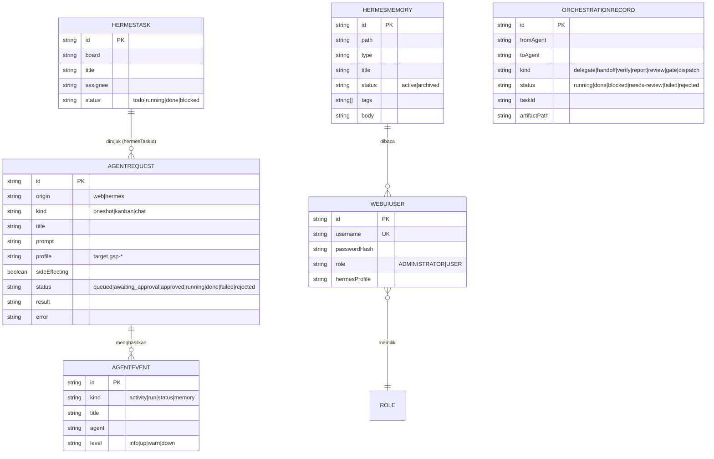

# Model Data — GSP Agent Headquarter

Seluruh model didefinisikan di `prisma/schema.prisma` (Prisma ORM, PostgreSQL).
Proyek ini **tanpa folder migrations** — perubahan schema diterapkan dengan `npx prisma db push`.

---

## 1. Diagram ER (inti message bus)

## 2. Kelompok Model

### Auth (NextAuth)
| Model | Keterangan |
|---|---|
| `Account` | Akun OAuth (Google) per user |
| `Session` | Sesi NextAuth |
| `User` | Pengguna |
| `VerificationToken` | Token verifikasi |

### Hermes Bus (website ↔ agen)
| Model | Keterangan |
|---|---|
| `AgentRequest` | **Inti dispatch**: permintaan dari website ke agen. Status: `queued` → `approved`/`running` → `done`/`failed`/`rejected`; `awaiting_approval` menunggu persetujuan |
| `AgentEvent` | Activity feed: `activity`/`run`/`status`/`memory`, level `info/up/warn/down` |
| `HermesTask` | Kartu kanban Hermes yang dimirror (`board`, `assignee`, `status`) |
| `HermesMemory` | Entri memori wiki (warm tier, markdown git yang dimirror) |
| `DataStore` | Generic key-value store (cron, health, konfigurasi — key `hermes-*`) |
| `Brief` | Daily brief per tanggal (`date` unik) |
| `Mission` | Misi per agen (status pending/active/completed/failed, prioritas) |
| `AgentState` | Status ringkas agen (offline/online, tasksCompleted, totalCost, recentActivity) |
| `AgentBusMessage` | Pesan antar-agen (fromAgent, toAgent, type, read) |

### Orkestrasi GSP
| Model | Keterangan |
|---|---|
| `OrchestrationRecord` | Satu baris = satu interaksi terarah profil A → profil B. `kind` menentukan jenis (delegate/handoff/verify/report/review/gate/dispatch); `status` menentukan hasil; `artifactPath` merujuk artefak sesuai Documentation Contract GSP |

### Konten
| Model | Keterangan |
|---|---|
| `Draft` | Draf konten X: teks, skor (viralScore, engagementScore), tier (`top20`/`bottom20`), status, jadwal, metrik |
| `TweetMetric` | Metrik tweet per draft (checkpoints JSON) |
| `Idea` | Ide konten (kategori, tipe, status) |
| `ContentCalendar` | Kalender konten per minggu (`week` unik, `data` JSON) |
| `YoutubeIdea` | Ide video YouTube: hook, angle, funnelStage, competitionScore (`gap/moderate/crowded`) |
| `YoutubeScript` | Skrip YouTube + SEO package (seoTitle, seoTags, seoChapters, titleVariants, thumbnailConcept) |
| `YoutubeFeedback` | Feedback judul video (alasan penolakan) |
| `LongformScript` | Skrip longform multi-platform + metrik performa (views, likes, comments) |
| `Article` | Artikel (track `mega-viral/local-viral/icp-viral`), quote-tweet, hero image, metrik |
| `SavedTitle` | Judul tersimpan |
| `ContentRequest` | Request pembuatan konten (prompt → resultDraftIds) |

### Client Pulse
| Model | Keterangan |
|---|---|
| `ClientPulseClient` | Klien: status, layanan, PM, jadwal renewal, expectedCheckinHours |
| `ClientPulseChat` | Chat Telegram yang terhubung ke klien |
| `ClientPulseMessage` | Pesan per chat (intent, sentiment, needsReply, dedup unik telegramChatId+messageId) |
| `ClientPulseAnalysis` | Analisis berkala: skor sentiment/response/cadence/renewal/overall, kategori, evidence, llmSummary |
| `ClientPulseAlert` | Alert per klien/chat (severity, reason, ack) |

### RBAC WebUI
| Model | Keterangan |
|---|---|
| `WebUiUser` | User WebUI: `username` unik, `passwordHash` (scrypt `salt:hash`), `role` (`ADMINISTRATOR`/`USER`), `hermesProfile` (pin ke profil — USER wajib unik per user; admin boleh berbagi) |

### Lainnya
| Model | Keterangan |
|---|---|
| `BattleRoyaleBot` | State bot (JSON) |

## 3. Catatan Operasional

- **Migrasi:** `npx prisma db push` (idempotent untuk penambahan kolom; hati-hati untuk drop).
- **Seed:** `npm run db:seed` → `prisma/seed.ts`.
- **Admin RBAC:** `node scripts/seed-webui-admin.mjs` (env `WEBUI_ADMIN_USERNAME`,
  `WEBUI_ADMIN_PASSWORD` min 8 karakter, `WEBUI_ADMIN_PROFILE` default `default`).
- **Password hash:** scrypt `salt:hash` (16-byte salt, 64-byte hash, hex).
- **Index penting:** hampir semua model ber-index pada `status`, `createdAt`, dan kolom relasi —
  lihat `@@index` di `schema.prisma`.
